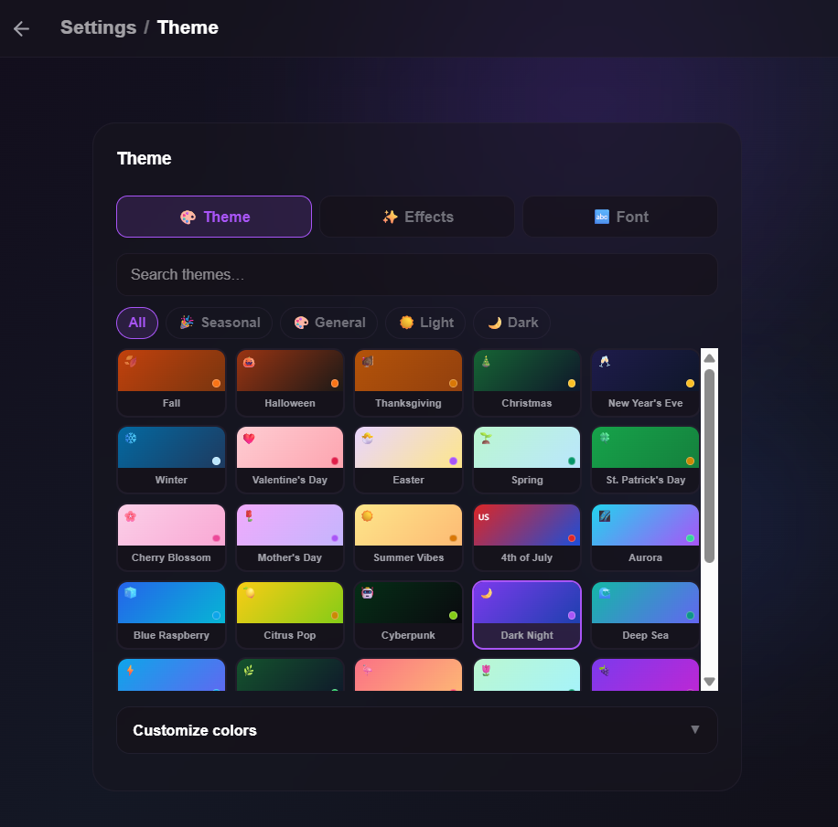

# Customizing Your Event Page

Make your event page feel like _your_ event. Open your event while signed in to access the host controls.

Event pages use a responsive, single-column layout that grows to 600px on larger screens while retaining comfortable side gutters on phones. The event settings, RSVP form, guest list, and theme previews follow the same width and atmosphere so the experience stays consistent as hosts and guests move between them.

---

## Inline Editing

When you view your own event, you can click directly on certain details to edit them in place — changes save automatically. You can edit these inline:

- **Title**
- **Description**
- **Location name** and **address**
- **Virtual event link**

Everything else — date and time, theme, RSVP rules, visibility, polls, and potluck — is changed from the event's **Settings** page.

The description editor expands with your text while you type. It starts at a comfortable multi-line height and grows until it reaches a mobile-friendly portion of the viewport, then scrolls internally so a long description never takes over the whole screen.

> **Tip:** Add `?preview=1` to the end of your event's web address to see the page exactly as a guest sees it, without losing your host controls.

---

## Themes

The **Settings → Theme** section is organized into three tabs: **🎨 Theme** (presets and custom colors), **✨ Effects** (the animated background layer), and **🔤 Font** (your event title font).

### Theme Customization Preview

Choose a preset, then customize the event's colors, background effects, and title font.

On the **Theme** tab, choose a base look from the theme picker:

- **Dark & Moody** — deep background with high-contrast text.
- **Soft & Dreamy** — pastel tones and gentle contrast.
- **Bold & Colorful** — vivid, high-contrast layouts.

Your site's administrator may publish additional **theme presets** that also appear here. All of
them are shown at once in a grid that grows with the page, with the applied preset outlined.

Buttons, fields, switches and save messages on your event page, its **Settings** and the RSVP
form all take your theme's colors and button style, so they look the same on every screen and
stay readable on light and dark themes alike. The site's own controls stay dark on every theme,
with your accent color: the header at the top of the page, the **Settings** bar, and the host
bar at the bottom of your page with its dialogs.

Text colors adjust automatically so guests can read them on your colors and card opacity. On a
**Bold & Colorful** page, the title, host line and date turn dark on light gradients, and on
mid-tone gradients a soft dark shade sits behind them so the white text stays clear. Your
gradient, accent and fonts never change.

### Accent Color

A color picker sets the accent color used for buttons, links, and highlights. Where the accent is
used for text, such as links, it is shown a little lighter or darker if needed so it stays
readable.

### Event Title Font

On the **Font** tab under **Settings → Theme** you can pick a font for your event's main title. Section headings and body text stay in the standard font for readability. Twelve fonts are available across four moods — elegant serifs (Playfair Display, DM Serif Display, Lora), poster styles (Bebas Neue, Righteous, Fredoka), scripts (Pacifico, Dancing Script, Caveat), and modern sans-serifs (Roboto, Space Grotesk, Outfit) — plus **Theme default**, which keeps each base look's built-in title typography. Some presets apply a matching font automatically; you can always override it.

Fonts are bundled with the app — nothing is loaded from external services, and guests only download a font if your event actually uses it.

### Effects (Animated Backgrounds)

The **Effects** tab in **Settings → Theme** adds an optional layer of gently drifting motifs behind your page — falling autumn leaves, floating balloons, rising fireworks, drifting turkeys, snow, confetti, and more (19 ready-made sets in all, including a beer toast 🍺) — or a mix of icons you choose yourself.

- **Off by default.** Effects are purely opt-in and fully independent of your theme — put turkeys on a St. Patrick's theme if that's your party.
- **Ready-made sets** appear as soon as you open the tab, with **None** first. Seasonal effects near your current date sort to the front as suggestions — nothing is ever applied automatically.
- **Search for icons.** Type in **Search icons** to find more than 3,700 Noto Emoji icons, one for every emoji. Search works in English, Dutch, German and Spanish at the same time, whatever language the app is in — "cat", "kat", "Katze" and "gato" all find cats — and ignores capitals and accents. You can also paste an emoji, such as 🎉 or 👋🏽, to find it directly. Results show their names in your language; **Load more** shows the next page. Clear the search to see the ready-made sets again.
- **Mix up to three icons.** Click an icon to add it to **Your mix**; the motifs take turns evenly across the background. Click it again, or use its remove button, to take it out. Removing the last icon turns the effect off, and choosing a ready-made set replaces the mix.
- **Amount** (Less / Some / More) sets how many motifs drift by — and only that.
- **Size** sets how big they are: **Small** (3×), **Medium** (5×) or **Large** (7×), or drag the slider (or use the arrow keys) anywhere from 1× to 10× in half steps. The current size is shown next to the slider. Each motif still varies a little in size so the layer keeps its organic feel. New effects start at Small.
- **Speed** (Gentle / Medium / Lively) controls how fast.
- **Movement** sets the direction for the whole effect: **Up**, **Down**, or **Random**, where each motif drifts across on its own path — sideways and diagonally too. Ready-made sets keep their usual direction (falling leaves, rising balloons) until you pick one; a mix of icons starts with Random.
- Amount, Size, Speed and Movement are independent: changing one never changes another, and changing the motifs keeps them all.
- **If you set your effect before November 2026:** for a short time, Amount also set the size (More doubled it) and the size slider was gone. Size is its own control again. Whatever size your event has now — including one set by the old slider or by that Amount choice — is kept exactly as it is; adjust it with Size if you like.
- Confetti and balloons tint themselves to match your theme's colors. Library icons keep their own colors.
- Everything is part of RSVP to Me itself: icons, their names and the search all run on your RSVP to Me site, with no outside icon or translation service. The artwork's licenses are listed under [Icon credits](#icon-credits).
- Guests who have "reduce motion" enabled in their device accessibility settings see a calm, static page — the animation layer hides itself automatically.
- Every visitor can choose **"✨ Hide effects"** from the menu in the top bar, so anyone who finds the animation distracting can turn it off for themselves. Signed-in visitors open the menu from their profile picture; signed-out visitors use the circular hamburger button. The choice is remembered in their browser and doesn't affect anyone else.
- Effects follow guests and hosts across the event page, RSVP form, guest list, and event settings. **Emails always stay static** by design.

#### Icon credits

The searchable effect icons come from an open-source collection, included unchanged:

- **Noto Emoji** by Google, Apache License 2.0 — [license](/effects/library/noto/1.2.10/LICENSE.txt), [notice](/effects/library/noto/1.2.10/NOTICE.txt) and [regional-flag notice](/effects/library/noto/1.2.10/REGION-FLAGS-LICENSE.txt).
- Icon names and search words in all four languages come from the Unicode CLDR project, Unicode License v3 — [license](/effects/library/cldr/49.0.0/LICENSE.txt).

Your theme isn't just for the event page — the **emails** your guests receive (invites, confirmations, reminders) are styled to match it too, including an email-safe version of your heading font. Email text is adjusted to stay readable in every mail app: links appear in a deeper shade of your accent color, and on some bold gradients the email title uses a dark ink where your page shows white text over a soft shade. You can preview them under **Settings → 💌 Emails**. See [Messaging Guests & Reminders](/help/messaging-and-reminders) for details.

---

## Cover Image

Upload a cover photo to set the mood:

- Supported formats: JPEG, PNG, GIF, WebP. Use one of these formats when replacing a cover image; AVIF is not a supported upload format.
- Maximum file size: 8 MB.
- Large images are automatically resized in your browser (up to 1600×900) before uploading, so uploads stay fast.
- The server automatically delivers responsive image sizes and modern formats for event covers and profile photos. The original upload remains unchanged for backups and email-client compatibility.
- **Aspect Ratio:** On the event page itself, the cover image renders with its natural aspect ratio (automatically scaling between a height of 200px and 450px depending on the width and shape). On your dashboard list and public feeds, cover photos are cropped to a uniform 4:3 grid aspect ratio.

---

## Info Sections

Info sections show short, scannable details — parking, dress code, links — as chips on your event page.

- **Icons:** choose from a set (shirt, utensils, parking, link, phone, and more).
- **Links:** only regular web links (`http://` or `https://`) are accepted; a bare link like `example.com/page` gets `https://` added for you.
- **Ordering:** drag and drop chips to reorder them.

## Preset effects and occasions

Occasions includes Birthday, Graduation, Wedding, Baby Shower, Anniversary, Retirement,
Housewarming and Reunion. Seasonal and party presets can include effects. General color
styles have no effect by default (including Enchanted Forest).

Selecting a preset applies its theme and effects together. In Effects, remove any icon
from Your mix, search for replacements, or select None. Amount, Size, Speed and Movement
remain independent. None stays off until you choose another effect or apply a preset.
Restoring defaults brings back the preset's current theme, font and effect after you
confirm with **Restore**. Choosing a different preset while your settings are customized
asks before replacing them.

Soft & Dreamy spreads translucent colors across the page and drifts slowly. Reduced
motion shows the same colors without animation.

A preset you just applied never shows a customization warning or a Restore button. If an
administrator later changes the preset, Restore brings your page to its new settings.
Confirmation dialogs center on the screen and shade the entire viewport.
